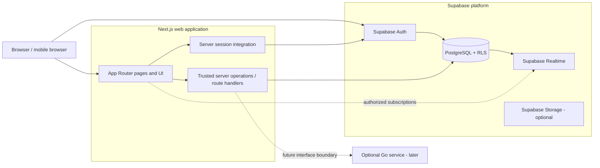

# DropIn — High-Level Design

**Status:** Proposed design for the first usable release  
**Product requirements:** [`../DropIn.md`](../DropIn.md)  
**Implementation roadmap:** [`../DROPIN_IMPLEMENTATION_PLAN.md`](../DROPIN_IMPLEMENTATION_PLAN.md) (local planning file; intentionally gitignored)

## 1. Purpose and scope

This document describes the system shape, responsibilities, boundaries, and key design choices for DropIn's first release. It is a design target, not a statement that these capabilities are implemented. The repository currently contains a basic Next.js scaffold; the application backend, database, auth, and product flows remain future work.

The first release focuses on online Drops: create, discover, join/leave, and communicate in a text-based activity room. Nearby Drops, exact or approximate location processing, voice/video, social connections, advanced recommendations, and a dedicated Go service are outside this release.

## 2. System goals

- Make current, joinable activities the center of the product.
- Provide a fast responsive web experience across desktop and mobile browsers.
- Keep persistent business state and authorization in PostgreSQL/Supabase, not in client state.
- Support live updates while tolerating missed events, disconnects, and reconnects.
- Enforce membership, capacity, expiry, privacy, and ownership at trusted boundaries.
- Start with a small deployable system and keep a seam for an optional future Go service.
- Keep required infrastructure within the product's free/open-source preference, recognizing provider quotas and plan changes.

## 3. Proposed architecture

The diagram shows logical boundaries. Exact request paths and hosting compatibility must be confirmed before deployment. Supabase is the initial backend platform: Auth provides identity, PostgreSQL owns domain state and access policies, and Realtime delivers changes to authorized clients. Next.js renders the web product and can host small trusted operations. Business-critical operations may be implemented as PostgreSQL functions/RPCs, server route handlers, or Edge Functions; choose one trusted boundary per operation and keep validation and authorization consistent.

## 4. Component responsibilities

| Component | Responsibility | Does not own |
|---|---|---|
| Next.js web app | Routes, responsive UI, rendering, interaction state, share landing pages | Authoritative membership counts, capacity, or ownership |
| Next.js server layer | Session-aware orchestration and operations that should not run with browser credentials | Long-running realtime infrastructure in the initial release |
| Supabase Auth | Email/Google identity and session lifecycle | Drop domain rules |
| PostgreSQL | Durable profiles, Drops, memberships, messages, reports; constraints, transactions, RLS | UI presentation or delivery guarantees for realtime events |
| Supabase Realtime | Low-latency broadcasts/row-change delivery for authorized clients | Durable source of truth or guaranteed exactly-once delivery |
| Supabase Storage (optional) | Profile avatars and approved assets | Executable/user-controlled public content policy |
| Cloudflare Pages (proposed) | Static and/or compatible Next.js application hosting | Database or identity authority |
| Future Go service (deferred) | Dedicated APIs, custom WebSockets, workers or concurrency-heavy needs if evidence supports it | Replacement for PostgreSQL as domain source of truth |

## 5. Main request and event flows

### 5.1 Sign in

1. Browser starts an email or Google sign-in flow with Supabase Auth.
2. Auth returns a session using the chosen secure session mechanism.
3. Next.js server and browser clients derive user identity from the validated session.
4. Profile setup is requested only when required fields are missing.
5. Protected queries are additionally constrained by PostgreSQL RLS.

### 5.2 Create a Drop

1. User submits a small validated form.
2. Trusted server/database operation derives `creator_id` from the authenticated identity.
3. Operation validates title/category/duration/capacity/visibility and calculates timestamps server-side.
4. PostgreSQL inserts the Drop and creator membership transactionally if creator membership is part of the selected model.
5. The UI receives the persisted record and navigates to its activity page.

### 5.3 Discover and join

1. The browser requests a paginated list of Drops whose lifecycle, time, visibility, and availability qualify for discovery.
2. PostgreSQL filters and sorts records using indexed fields and RLS.
3. Join is submitted to a trusted transactional operation. The operation rechecks user, current status, expiry, and available capacity inside the transaction.
4. PostgreSQL commits membership; a uniqueness rule prevents duplicate active membership.
5. Realtime informs subscribers of membership/availability changes. Clients update from events and periodically reconcile with authoritative reads after reconnect.

### 5.4 Chat

1. Client verifies the user is authenticated and opens the activity room.
2. PostgreSQL RLS allows message history only to eligible participants and according to the room's visibility policy.
3. Message creation checks membership and content limits at a trusted boundary.
4. PostgreSQL persists a message; Realtime delivers it to authorized subscribers.
5. On reconnect, client fetches messages after its last stable message ID/time and deduplicates by message ID.

### 5.5 Invitation link

1. A stable Drop URL opens a public-safe landing page.
2. Landing data reveals only fields intended to be public; no private room messages or exact private data.
3. An unauthenticated user signs in and the requested Drop ID is retained in a validated return path.
4. The user returns to that Drop and submits the normal transactional join operation.

## 6. Trust and data boundaries

- Browser values are untrusted. Counts, creator identity, participant role, capacity, status, and expiry are recalculated or derived on the server/database.
- Public/anonymous landing reads are separate from participant-only room reads.
- Supabase anon/publishable credentials may be used in browser code only with strict RLS. Service-role keys remain server-only and should be avoided when an authenticated database operation suffices.
- Realtime channels and subscriptions must follow the same visibility/membership model as database reads.
- Exact user location is not collected in the first release. Future nearby discovery needs a separate privacy and threat model before schema or UI work.
- Logs and error reporting must not include access tokens, service credentials, private message bodies, or precise location.

## 7. Deployment and environments

### Environments

- **Local:** Next.js dev server and local Supabase stack/CLI where practical; local-only environment values ignored by Git.
- **Preview:** isolated or deliberately shared non-production Supabase project with test data and configured auth callback URLs.
- **Production:** hosted Next.js application and production Supabase project with migrations applied explicitly.

Environment variables should be documented by name and exposure class. Browser-exposed variables use the framework's public prefix and contain only publishable values. Secrets and service role credentials must never use a public prefix. No real credentials belong in this repository.

Cloudflare Pages is the proposed frontend host in the product specification, but Next.js server rendering and server operations must be verified against the chosen Cloudflare adapter/runtime before committing to an architecture that depends on them. If the desired server features are unsupported or costly in the chosen configuration, select a compatible free-tier host or keep those operations in Supabase Edge Functions. The decision should be recorded before launch.

## 8. Quality attributes

- **Consistency:** database constraints and transactions protect participant and capacity invariants.
- **Availability:** core reads/writes remain usable if a realtime subscription reconnects; realtime is an enhancement to persisted state.
- **Performance:** paginated discovery, indexed filters, bounded message history, optimized images, and scoped subscriptions.
- **Security:** RLS, session-derived identity, boundary validation, rate limiting, secret isolation, safe return URLs.
- **Privacy:** minimal profile fields exposed, public landing separate from room access, no location in initial release.
- **Accessibility:** semantic content, keyboard operation, visible focus, labels, contrast, reduced motion, mobile-friendly controls.
- **Portability:** domain rules are explicit and documented; avoid tying core rules to UI components or provider-only client assumptions.

## 9. Deferred evolution

Add a Go service only when concrete operational needs justify it, such as custom socket lifecycle, worker processing, or load that the initial platform cannot handle economically. Keep database transactions and RLS as the security baseline during migration; a Go API must authenticate users, enforce the same rules, and not create a parallel source of truth. Nearby Drops, Redis, notifications, and advanced recommendations likewise require separate design and scope decisions.

## 10. Decisions still to make before dependent implementation

1. Exact Supabase SSR/session package and session/cookie integration for the selected Next.js runtime.
2. Hosting target and support for required Next.js server features.
3. Trusted-operation placement for create/join/leave/send-message: database RPC, Next.js route handler, or Supabase Edge Function per operation.
4. Exact public/private Drop semantics and whether unlisted/share-link Drops are part of release one.
5. Creator membership, leave/rejoin rules, retention of departed membership, and cleanup/archival policy.
6. Message retention, edit/delete policy, and moderation workflow.
7. Free-tier limits to monitor and a safe response when quotas are reached.

## 11. Implementation status

This is a proposed target. The repo currently has the generated Next.js/TypeScript/Tailwind/ESLint scaffold only. Supabase, authentication, schema, RLS, realtime subscriptions, server operations, and deployment are not yet implemented or verified.
